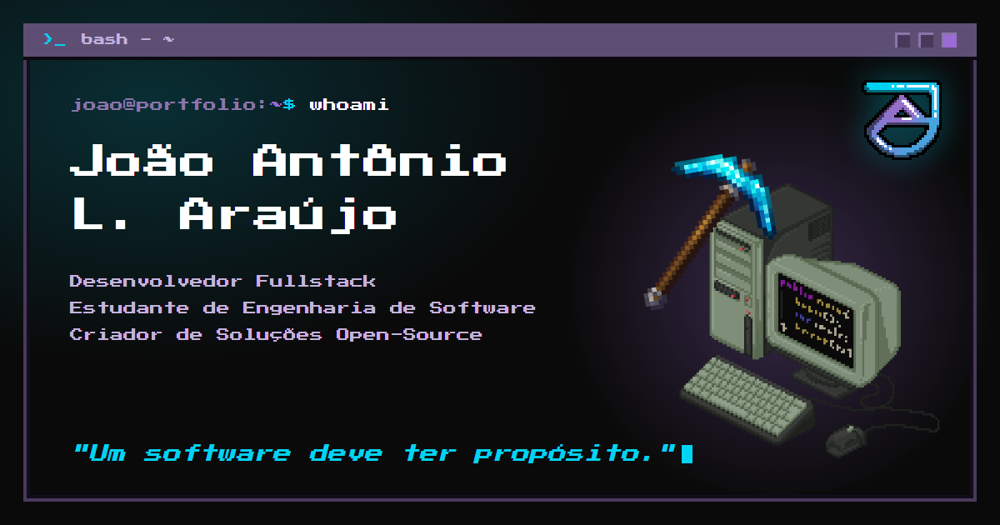
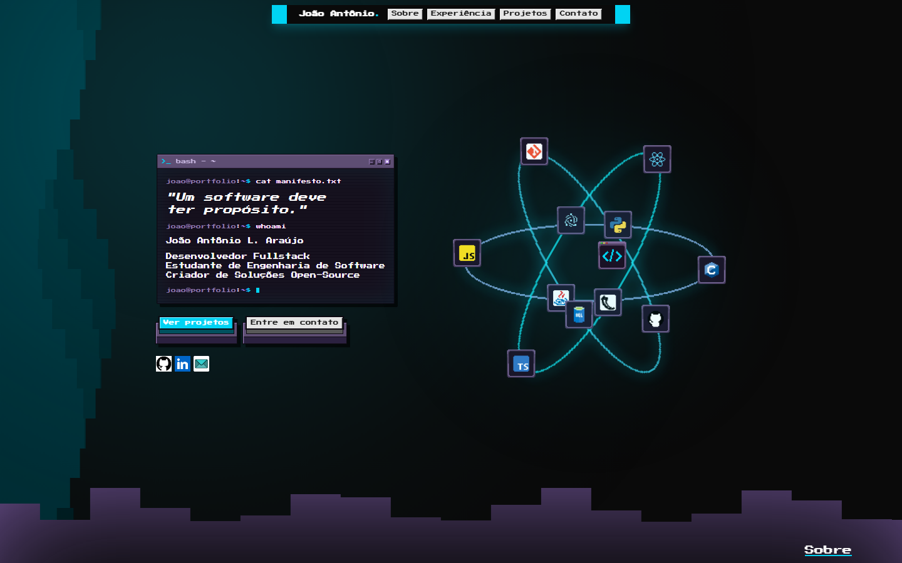
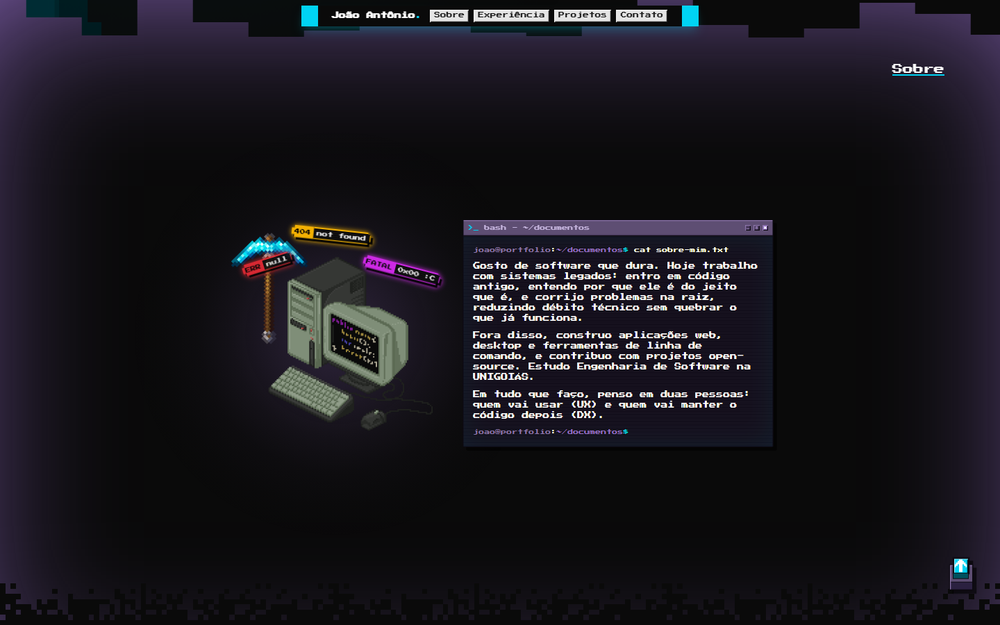
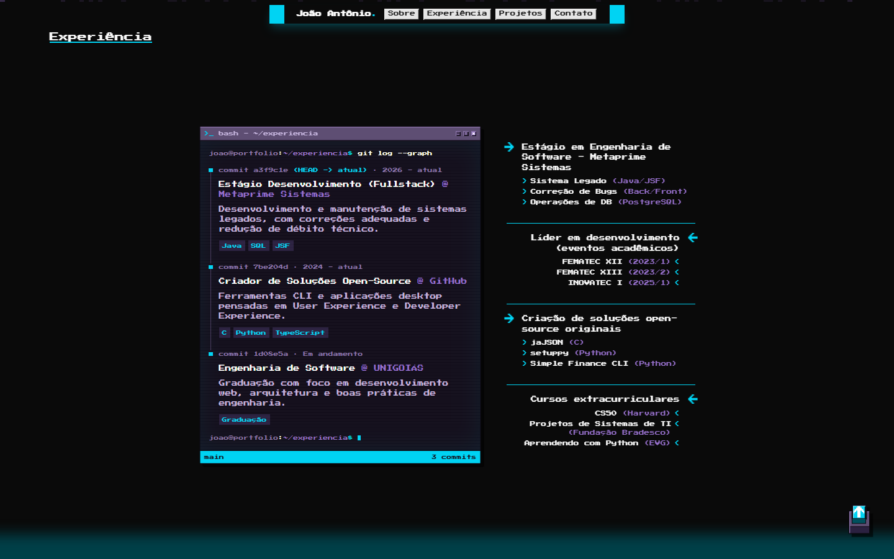
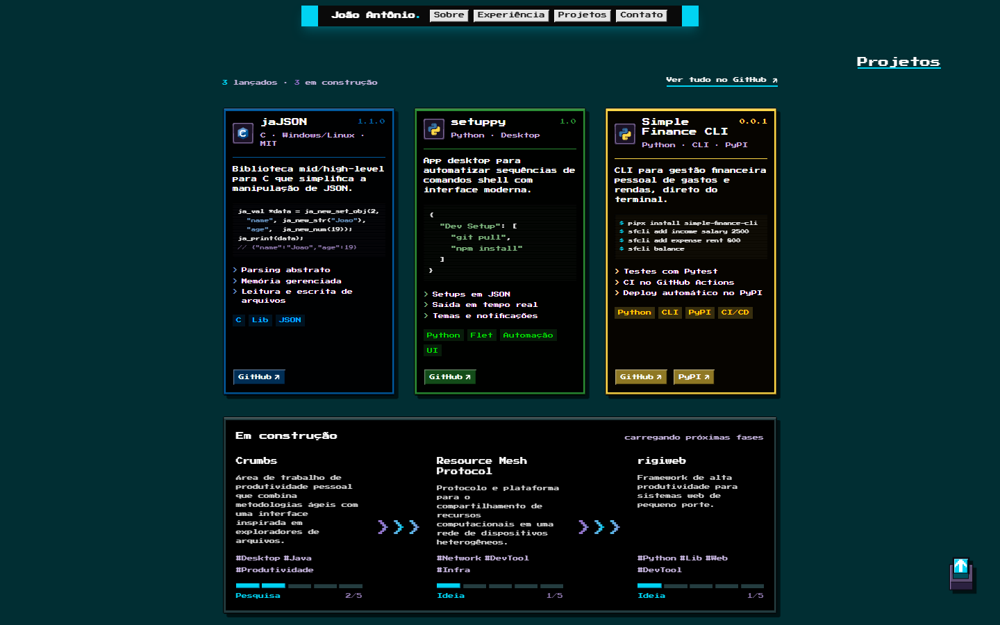
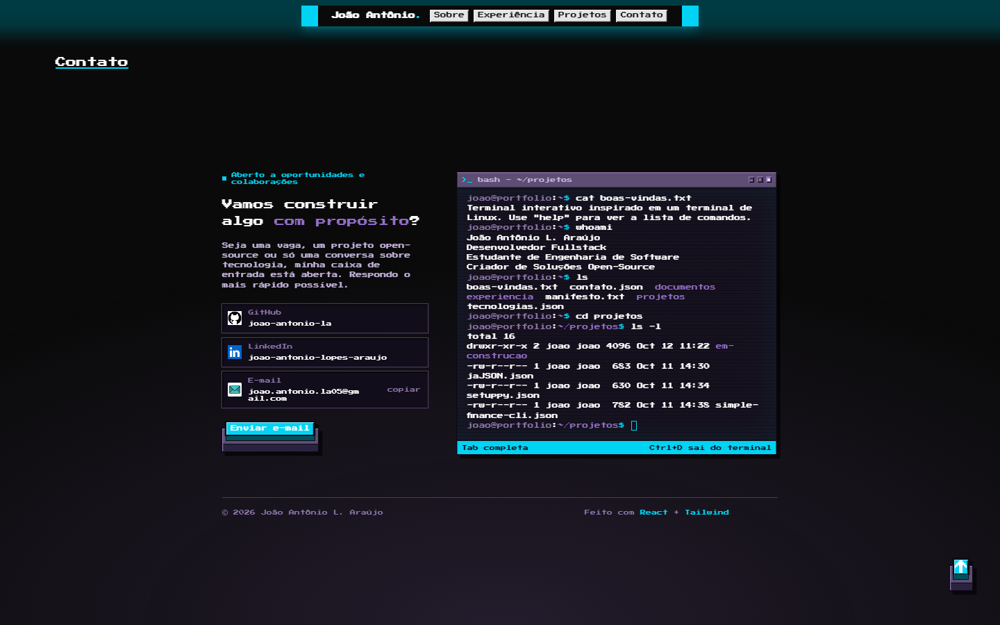

<div align="center">


# Portfólio — João Antônio

**Acesse: [joao-antonio-la.github.io](https://joao-antonio-la.github.io)**

[](https://github.com/joao-antonio-la/joao-antonio-la.github.io/actions/workflows/deploy.yml)

Portfólio pessoal em pixel art, com cara de fliperama e um terminal de verdade: todo o conteúdo do site vive num
sistema de arquivos virtual que você pode explorar com `ls`, `cd` e `cat`.

[](https://joao-antonio-la.github.io)

</div>

## Destaques

- **Terminal interativo**: `ls` (com `-a` e `-l`), `cd`, `cat`, `clear` e os atalhos `help` e `whoami`, imitando a
  saída do bash e do GNU coreutils, com histórico, autocomplete no Tab e os atalhos Ctrl+C, Ctrl+L e Ctrl+D.
- **Conteúdo como sistema de arquivos**: cada texto, projeto e experiência é um arquivo em `src/content`, a mesma árvore
  que o terminal navega. É a única origem de informação do site: as seções, as metatags e a versão sem JavaScript leem
  dali.
- **Pixel art feita com CSS**: molduras, botões de fliperama, cantos em degrau e efeito de tela CRT sem imagens. As
  animações pausam fora da tela e respeitam a preferência de reduzir movimento.
- **Pronto para compartilhar**: título, descrição, Open Graph e imagem de prévia gerados no build, fonte servida pelo
  próprio site e uma versão `<noscript>` com os contatos.
- **Acessível e responsivo**: navegação por teclado, suporte a leitores de tela e layouts testados de 320 a 1920px.

## Galeria

<table>
  <tr>
    <td></td>
    <td></td>
  </tr>
  <tr>
    <td></td>
    <td></td>
  </tr>
</table>

## Terminal interativo



```console
joao@portfolio:~$ whoami
João Antônio L. Araújo
Desenvolvedor Fullstack
Estudante de Engenharia de Software
Criador de Soluções Open-Source
joao@portfolio:~$ ls
boas-vindas.txt  contato.json  documentos  experiencia  manifesto.txt  projetos  tecnologias.json
joao@portfolio:~$ cd projetos
joao@portfolio:~/projetos$ ls
em-construcao  jaJSON.json  setuppy.json  simple-finance-cli.json
```

| Tecla           | Ação                                                        |
| --------------- | ----------------------------------------------------------- |
| Tab             | Completa comandos e caminhos; o segundo Tab lista as opções |
| Seta cima/baixo | Navega pelo histórico                                       |
| Ctrl+C          | Cancela a linha                                             |
| Ctrl+L          | Limpa a tela (como o `clear`)                               |
| Ctrl+D          | Sai do terminal e devolve o foco à página                   |

## Stack

- [React 19](https://react.dev) + [TypeScript](https://www.typescriptlang.org)
- [Vite](https://vite.dev)
- [Tailwind CSS v4](https://tailwindcss.com) + [tailwind-merge](https://github.com/dcastil/tailwind-merge)
- [ESLint](https://eslint.org) e [Prettier](https://prettier.io), com ordenação de classes do Tailwind
- [GitHub Actions](https://docs.github.com/actions) e [GitHub Pages](https://pages.github.com) para o deploy

## Como rodar

Requer [Node.js](https://nodejs.org) 22 ou superior.

```bash
npm install
npm run dev
```

| Script                 | Descrição                                       |
| ---------------------- | ----------------------------------------------- |
| `npm run dev`          | Servidor de desenvolvimento com HMR             |
| `npm run build`        | Checagem de tipos e build de produção em `dist` |
| `npm run preview`      | Serve o build de produção localmente            |
| `npm run lint`         | ESLint                                          |
| `npm run format`       | Formata o projeto com Prettier                  |
| `npm run format:check` | Verifica a formatação sem alterar arquivos      |

## Conteúdo

`src/content` é a única origem das informações do site. A árvore de pastas espelha a do terminal a partir da raiz:
`src/content/home/joao/documentos/quem-sou-eu.txt.ts` aparece como `~/documentos/quem-sou-eu.txt`.

```
src/content/
├── schema.ts                         Formato de cada tipo de arquivo
└── home/joao/                        ~
    ├── manifesto.txt.ts              Lema do início
    ├── contato.json.ts               E-mail, GitHub e LinkedIn
    ├── tecnologias.json.ts           Tecnologias da órbita do início
    ├── boas-vindas.txt.ts            Mensagem inicial do terminal
    ├── documentos/
    │   ├── quem-sou-eu.txt.ts        Nome e papéis (início, rodapé, metatags e whoami)
    │   ├── sobre-mim.txt.ts          Seção Sobre
    │   └── ajuda.txt.ts              Ajuda do terminal (help)
    ├── experiencia/
    │   ├── historico.json.ts         Linha do tempo da Experiência
    │   └── destaques.json.ts         Destaques da Experiência
    └── projetos/                     Um arquivo por projeto, na ordem do ls
        └── em-construcao/            Roadmap
```

Cada arquivo exporta um `ContentFile` validado com `satisfies`, então o TypeScript acusa campos faltando ou com nome
errado:

```ts
import type { ContentFile, ProjectData } from "@/content/schema";

export default {
  modified: "2026-10-11T14:30:00",
  content: {
    name: "jaJSON",
    // ...demais campos de ProjectData
  },
} satisfies ContentFile<ProjectData>;
```

- O nome exibido no terminal é o do arquivo sem o `.ts`.
- Arquivos `.txt` guardam uma lista de linhas; arquivos `.json` guardam qualquer valor e aparecem formatados no `cat`.
- O tamanho exibido no `ls -l` é calculado a partir do conteúdo.
- As seções leem os arquivos com `readText`, `readJson` e `readJsonDir` (`src/lib/filesystem.ts`), usando caminhos com
  `~`.

Para adicionar um projeto, crie `src/content/home/joao/projetos/<nome>.json.ts` com
`satisfies ContentFile<ProjectData>`. Ele aparece no site e no terminal.

## Deploy

O site é publicado em **[joao-antonio-la.github.io](https://joao-antonio-la.github.io)** pelo workflow
`.github/workflows/deploy.yml`, a cada push na `main` ou manualmente pela aba Actions. Ele instala as dependências,
roda lint, checagem de formatação e build, e só publica a pasta `dist` se tudo passar.

- **Endereço**: o build usa caminhos relativos (`base: "./"` no `vite.config.ts`), então funciona na raiz do domínio,
  num subcaminho ou num domínio próprio sem mudar nada.
- **Metatags**: o `index.html` é preenchido no build a partir de `src/content` (plugin `siteHtml` no `vite.config.ts`):
  título, descrição, Open Graph, Twitter e a versão `<noscript>`. As tags que exigem URL absoluta (`canonical`,
  `og:url` e `og:image`) usam a variável `SITE_URL`, que o workflow obtém do `actions/configure-pages`.
- **Imagem de prévia**: `public/og-image.png` (1200×630) tem o nome, os papéis e o lema desenhados e precisa ser refeita
  se eles mudarem.
- **Configuração do repositório**: **Settings → Pages → Build and deployment → Source: GitHub Actions**.

## Estrutura

```
.github/
├── readme/               Capturas de tela usadas neste README
└── workflows/            Deploy no GitHub Pages
public/
├── fonts/                Press Start 2P (woff2, subconjunto latino) e licença OFL
├── favicon.ico           Favicon de 32px
├── favicon-96.png        Favicon de 96px (resultados de busca)
├── apple-touch-icon.png  Ícone de 180px para a tela inicial do iOS
└── og-image.png          Imagem de compartilhamento (Open Graph)
src/
├── assets/
│   ├── arts/             Monograma JA (512px), picareta, computador, anel e núcleo da órbita
│   └── icons/            Ícones por categoria: ui (seta, menu, fechar), social e tech
├── components/
│   ├── layout/           NavBar, Section, ScrollToTopButton
│   └── ui/               Button, ArcadeButton, PixelFrame, TerminalFrame, PixelDissolve e ícones
├── content/              Conteúdo do site (ver acima)
├── hooks/                use-offscreen-marker, use-has-scrolled-past
├── lib/
│   ├── filesystem.ts     Árvore de arquivos virtual e leitura do conteúdo
│   ├── contact.ts        E-mail e links sociais
│   ├── identity.ts       Perfil e URLs de contato (usado também pelo build)
│   ├── profile.ts        Nome, papéis e lema
│   ├── tech-icons.ts     Ícones de tecnologia por nome
│   ├── pixel-art.ts      Cantos em degrau e medidas em pixels de arte
│   ├── sections.ts       Ids das seções e rolagem
│   └── utils.ts          cn e atributos de link externo
├── sections/             Uma pasta por seção com seus subcomponentes
│   └── contact/terminal/ Interpretador (commands.ts) e autocomplete (completion.ts)
├── styles/
│   ├── base.css          Fonte, escala do rem e pausa das animações fora da tela
│   ├── animations.css    Animações reutilizáveis
│   ├── components/       CSS de cada componente
│   └── sections/         CSS de cada seção, com seus keyframes
└── index.css             Entrada do CSS e tema
```

## Convenções

- Componentes em PascalCase (`PixelFrame.tsx`); o resto em kebab-case (`pixel-art.ts`, `pixel-frame.css`).
- Componentes como arrow functions com `return`, e props tipadas em `type NomeProps`.
- Imports na ordem: externos, `@/` em ordem alfabética e relativos.
- Constantes de módulo em `UPPER_SNAKE_CASE`.
- Classes CSS próprias em BEM (`bloco__elemento--modificador`) dentro de `@layer components`, para que as utilitárias
  do Tailwind possam sobrescrevê-las.
- Medidas de pixel art em `--px` e tamanhos de texto pelos tokens do tema (`text-2xs`), com mínimo de 8px.
- Formatação pelo Prettier (`npm run format`), que também ordena as classes do Tailwind.

## Créditos

A fonte [Press Start 2P](https://fonts.google.com/specimen/Press+Start+2P), de CodeMan38, é servida pelo próprio site
e distribuída sob a [SIL Open Font License 1.1](public/fonts/OFL.txt).
